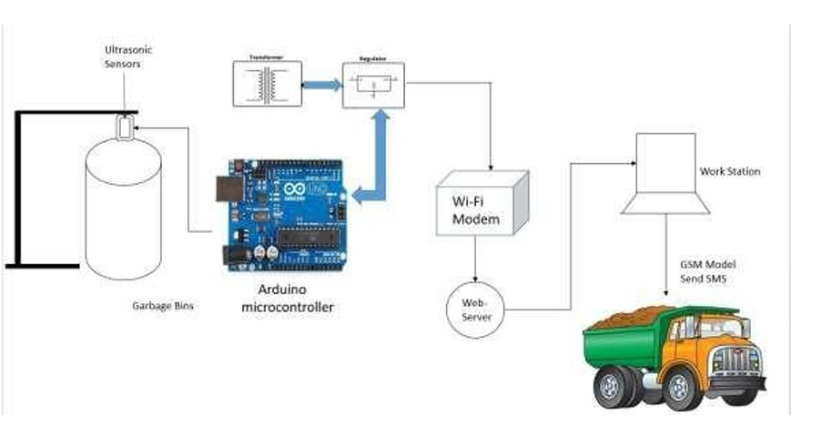
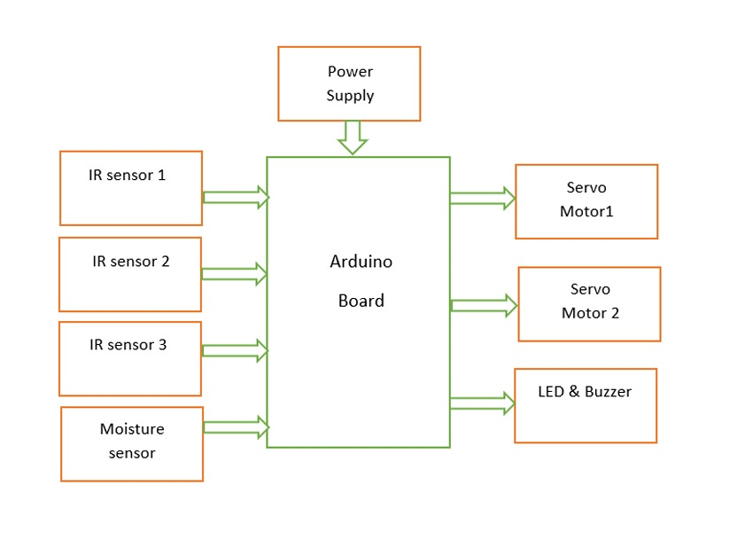
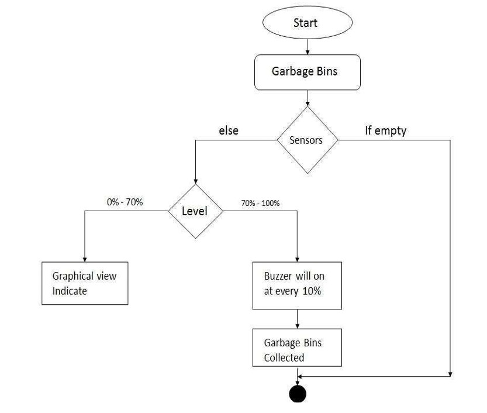

# Smart Garbage Monitoring System

**IoT | Arduino | ESP8266 | Wireless Networking | GSM | Embedded Systems**

## Project Overview

Smart Garbage Monitoring System is an academic Internet of Things (IoT) project developed to improve waste-bin monitoring, automate aspects of waste segregation, and support timely waste collection.

The system design combines microcontroller-based sensor processing with wireless communication, garbage-level monitoring, and threshold-based alerts.

**Project Type:** Bachelor of Engineering — Academic Team Project  
**Academic Year:** 2022–2023  
**Institution:** B.N.M. Institute of Technology, Bengaluru  
**Department:** Electronics and Communication Engineering

## Project Objectives

- Monitor garbage levels using ultrasonic sensing.
- Support automatic wet and dry waste segregation.
- Provide garbage-bin status information through a monitoring interface.
- Use wireless communication to support remote monitoring.
- Alert responsible personnel when waste reaches a defined threshold.
- Reduce the need for manual inspection of garbage bins.

## System Architecture

The project documentation describes an architecture connecting sensor-equipped bins, microcontroller-based processing, Wi-Fi communication, a monitoring interface, and GSM-based notifications.

The Arduino-based implementation diagram also shows IR sensors and a moisture sensor providing inputs to a controller, with servo motors, LEDs, and a buzzer as outputs.

## Hardware and Software

| Component | Purpose |
|---|---|
| Arduino microcontroller | Sensor processing and output control |
| Ultrasonic sensor | Garbage-level and object detection |
| ESP8266 Wi-Fi module | Wireless connectivity |
| GSM module | SMS-based alert communication |
| IR sensors | Object detection and monitoring functions |
| Moisture/rain sensor | Wet and dry waste identification |
| Servo motors | Mechanical movement and waste handling |
| LED and buzzer | Local status and alert indications |
| Arduino IDE | Microcontroller programming |

## System Workflow

1. Initialize the controller, sensors, and communication modules.
2. Detect an object or garbage using the sensor arrangement.
3. Identify the waste condition using the relevant sensors.
4. Process sensor readings through the microcontroller.
5. Operate the mechanical system to direct waste into the appropriate compartment.
6. Monitor garbage levels against defined limits.
7. Generate local alerts or notifications when a threshold is reached.
8. Allow the responsible personnel to respond and reset the system following collection.

## Networking and IoT Concepts

This project provided practical exposure to:

- IoT device communication and sensor integration.
- ESP8266 Wi-Fi connectivity and TCP/IP networking concepts.
- Microcontroller-to-sensor interfacing.
- GSM-based remote alert communication.
- Remote monitoring architecture.
- Threshold-based event processing.

## Implementation and Results

The academic report documents the design and construction of a prototype, including physical hardware photographs, system diagrams, and the planned operating workflow.

The report describes successful wet/dry waste segregation and garbage monitoring functionality.

Quantitative measurements such as classification accuracy, communication latency, and long-term deployment reliability were not provided in the available documentation.

## Project Documentation

The supporting academic report and presentation cover:

- Project motivation and objectives.
- Literature review.
- System architecture.
- Hardware and software components.
- Implementation block diagram.
- Operating flowchart.
- Prototype photographs.
- Conclusion and future applications.
  
### Detailed Technical Documentation

[View Complete System Architecture and Technical Documentation](docs/architecture.md)

  
---

## Architecture Diagrams & Prototype Demonstration

The following diagrams and photographs are taken from the original academic project report.

### 1. System Architecture

### 2. Hardware Block Diagram

### 3. System Flowchart

### 4. Hardware Prototype — Photograph 1

### 5. Hardware Prototype — Photograph 2

---

## Applications

- Smart-city waste management.
- Public garbage-bin monitoring.
- Waste segregation at the source.
- Environmental monitoring and municipal waste collection.

## Project Credits

Developed collaboratively as a final-year Bachelor of Engineering project by Priyanka S. and her academic teammates at B.N.M. Institute of Technology, under faculty supervision.

## Portfolio

[View My Network Engineering Portfolio](https://priyankasridhar17.github.io/priyanka-network-portfolio/)

[View My GitHub Profile](https://github.com/PriyankaSridhar17)
# smart-garbage-monitoring-system
IoT-based smart garbage monitoring system using ESP8266, Wi-Fi, GSM, and sensor-based monitoring.
