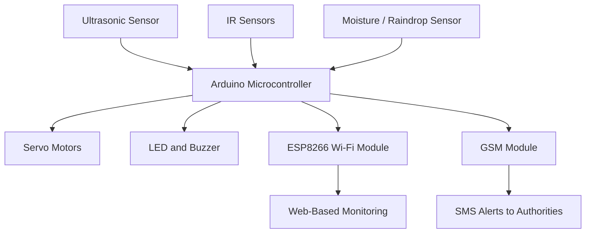
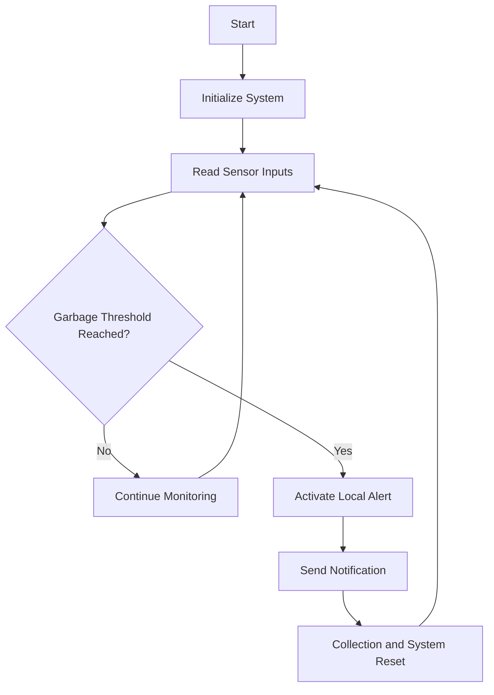

# Smart Garbage Monitoring System — Technical Architecture

## 1. System Overview

The Smart Garbage Monitoring System is an IoT-based academic project designed to monitor garbage levels, support wet/dry waste segregation, and generate alerts when waste bins require attention.

The documented system combines sensor-based detection, microcontroller processing, Wi-Fi communication, GSM messaging, and electromechanical waste-handling components.

**Project:** Smart Garbage Monitoring System  
**Institution:** B.N.M. Institute of Technology, Bengaluru  
**Academic Year:** 2022–2023  
**Domain:** IoT, Embedded Systems, Wireless Networking

---

## 2. High-Level System Architecture

The following diagram summarizes the functional architecture described in the project report.

This is a functional representation combining the monitoring architecture, hardware block diagram, and notification workflow presented in the academic report.

---

## 3. Hardware Architecture

### Arduino Microcontroller

The Arduino-based controller processes sensor inputs and controls output devices.

Responsibilities include:
- Reading sensor signals.
- Evaluating garbage-level conditions.
- Supporting wet/dry segregation decisions.
- Activating servo motors and local alerts.
- Interfacing with communication modules.

### Ultrasonic Sensor

The ultrasonic sensor uses transmitted and reflected ultrasonic pulses to detect object distance.

Within the project design, ultrasonic sensing supports garbage-level monitoring and object detection.

### IR Sensors

IR sensors provide additional detection inputs.

The project documentation also describes IR-based monitoring for bin security.

### Moisture / Raindrop Sensor

The moisture-sensing component supports identification of wet and dry waste.

Sensor readings are processed by the controller to support waste segregation.

### Servo Motors

Servo motors provide controlled movement of mechanical components.

The implementation diagram identifies two servo motor outputs connected to the Arduino controller.

### ESP8266 Wi-Fi Module

The ESP8266 provides wireless networking capability and supports TCP/IP connectivity.

The monitoring architecture describes transmitting garbage-bin status information to a web-based monitoring interface.

### GSM Module

The GSM module supports remote notifications using SMS.

The documented design uses GSM alerts to notify responsible personnel when a bin reaches a defined threshold.

### LED and Buzzer

LEDs and buzzers provide local status indications and audible alerts.

---

## 4. Sensor Processing and Waste Segregation

The project report describes the following operating sequence:

1. Initialize the microcontroller and sensor system.
2. Detect an object using the sensing arrangement.
3. Open the bin lid through the controlled mechanism.
4. Determine whether the waste is wet or dry.
5. Direct waste toward the corresponding compartment.
6. Monitor the garbage level.
7. Trigger an alert when the configured threshold is reached.
8. Notify responsible personnel and support reset after collection.

This sequence represents the workflow documented in the academic project.

---

## 5. Wireless Communication Architecture

### Wi-Fi Monitoring

The ESP8266 module provides wireless connectivity between the embedded monitoring system and the monitoring interface described in the report.

The project uses the concepts of:

- Wireless device connectivity.
- TCP/IP-based networking.
- Remote sensor-status monitoring.
- Communication between embedded devices and monitoring infrastructure.

The report does not specify a complete application-layer protocol, API format, or packet-level implementation.

### GSM Notification

The GSM module is described as an alerting interface.

When a configured condition is met, the system can initiate an SMS notification to designated personnel.

This provides an alternative notification path described in the project documentation.

---

## 6. Monitoring and Alert Workflow

This diagram is a simplified representation of the threshold-based monitoring and notification workflow.

---

## 7. Software Environment

**Development Environment:** Arduino IDE

The project documentation describes Arduino IDE for creating, compiling, and uploading microcontroller programs.

The project combines embedded control logic with wireless communication and sensor monitoring.

---

## 8. Implementation and Testing

The academic report contains:

- System architecture diagram.
- Arduino-based hardware block diagram.
- Garbage monitoring flowchart.
- Photographs of the assembled prototype.
- Documentation of the operating sequence.

The report describes successful wet/dry waste segregation and the development of an integrated garbage monitoring prototype.

No independently verifiable quantitative measurements of detection accuracy, wireless latency, or long-term system availability are provided.

---

## 9. Technical Skills Demonstrated

This project provides evidence of academic experience with:

- IoT system architecture.
- Microcontroller and sensor integration.
- ESP8266 Wi-Fi networking.
- TCP/IP communication concepts.
- GSM-based notification architecture.
- Embedded system control.
- Sensor-driven event processing.
- Hardware and software integration.

---

## 10. Project Credits

This was a collaborative Bachelor of Engineering academic project completed during 2022–2023 at B.N.M. Institute of Technology.

Team members:
- Priyanka S.
- Karnika S.
- Varsha A.

Faculty Guide: Dr. D. Bhuvana Suganthi

---

## 11. References

**Primary Documentation:** Smart Garbage Monitoring System — Final-Year Project Report and Project Presentation, B.N.M. Institute of Technology, 2022–2023.

[Return to Project README](../README.md)
